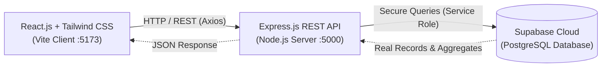

<<<<<<< HEAD
# Product Inventory Management System 📦

> **College Final Project** — A modern, fully functional full-stack Product Inventory Management System featuring full CRUD operations, dynamic analytics, category grouping, and automatic stock alerts. Built with **React.js**, **Express.js**, and **Supabase PostgreSQL**.

---

## 🌟 Key Highlights & Features

- **Preconfigured Administrator Authentication**:
  - Predefined admin username: `Adminclyde`.
  - Backend maps username `Adminclyde` to the administrator email configured in `ADMIN_EMAIL`.
  - Authenticated cryptographically via Supabase Auth.
  - Zero hardcoded passwords; passwords managed securely in Supabase.
  - All Dashboard, Products, and Categories API endpoints are protected with strict backend JWT authorization. Non-admin accounts are rejected.
  - Public registration disabled.
- **Full-Stack 3-Tier Architecture**:
  - **Frontend**: React 18, Vite, Tailwind CSS, React Router DOM, Lucide Icons, Axios.
  - **Backend Server**: Node.js, Express.js RESTful API, centralized error handling & input validation.
  - **Database Engine**: Supabase (Cloud PostgreSQL) with relational foreign key constraints, indexes, triggers, and Row Level Security (RLS).
- **Strict Data Pipeline**: The React frontend **never connects directly** to the database. All operations strictly flow through Express REST API endpoints, keeping the Supabase Service Role Key secure on the server.
- **Dynamic Real-Time Dashboard**:
  - Dynamic KPI cards: **Total Products**, **Total Stock Quantity**, **Low Stock Products**, **Out of Stock Products**, and Total Inventory Valuation.
  - Urgent Low-Stock alert table sorted by scarcity.
  - Recent products feed.
  - Department / Category stock volume progress distribution.
- **Complete Product CRUD**:
  - **Create**: Add new product with name, category, price, quantity, description, and image URL with real-time card preview and input validation.
  - **Read**: Fast tabular display with search by title/description, category filtering, stock status filtering, sorting, and pagination.
  - **Update**: Edit modal with pre-populated values and instant DB update.
  - **Delete**: Safe confirmation modal preventing accidental deletions.
- **Automatic Stock Status Indicators**:
  - 🟢 **In Stock**: Quantity &gt; 10 units
  - 🟡 **Low Stock**: Quantity between 1 and 10 units
  - 🔴 **Out of Stock**: Quantity = 0 units
- **Category Management**:
  - Add, edit, and view categories with dynamic product counters.
  - **Deletion Safeguard**: Prevents deleting any category that has active products assigned.
- **System Settings & Health Monitor**:
  - Live diagnostic card testing connection latency between React -> Express -> Supabase PostgreSQL.

---

## 🏗️ System Architecture



---

## 📁 Project Folder Structure

```text
product-inventory-system/
│
├── client/                               # Frontend React Application
│   ├── public/
│   ├── src/
│   │   ├── components/
│   │   │   ├── common/                  # Modal, Badge, Toast, ConfirmDeleteModal
│   │   │   ├── products/                # ProductFormModal, ProductDetailsModal
│   │   │   └── categories/              # CategoryFormModal
│   │   ├── layouts/
│   │   │   └── DashboardLayout.jsx      # Sidebar, Header, Breadcrumbs & Navigation
│   │   ├── pages/
│   │   │   ├── Dashboard.jsx            # Dynamic Analytics & Low Stock Alerts
│   │   │   ├── Products.jsx             # Product Catalog CRUD & Filters
│   │   │   ├── Categories.jsx           # Category Management & Relations
│   │   │   ├── Settings.jsx             # Profile, Diagnostics & Appearance
│   │   │   └── NotFound.jsx             # 404 Handler
│   │   ├── services/
│   │   │   ├── api.js                   # Central Axios Instance with Error Interceptor
│   │   │   ├── productService.js        # Products API Client
│   │   │   ├── categoryService.js       # Categories API Client
│   │   │   └── dashboardService.js      # Dashboard & Health API Client
│   │   ├── App.jsx                      # Router & Toast Provider
│   │   ├── main.jsx                     # Application Entry
│   │   └── index.css                    # Tailwind Directives & Custom Scrollbar
│   ├── index.html
│   ├── tailwind.config.js
│   ├── postcss.config.js
│   ├── vite.config.js                   # Development Server Proxy (:5000)
│   └── package.json
│
├── server/                               # Backend Express REST API
│   ├── config/
│   │   └── supabase.js                  # Supabase Client Initialization
│   ├── controllers/
│   │   ├── productController.js         # CRUD logic, filters & stock calculation
│   │   ├── categoryController.js        # Category CRUD & relational validation
│   │   └── dashboardController.js       # Dynamic stats aggregation
│   ├── middleware/
│   │   ├── validator.js                 # Server-side input validation
│   │   └── errorHandler.js              # Centralized JSON error handling
│   ├── routes/
│   │   ├── productRoutes.js             # /api/products
│   │   ├── categoryRoutes.js            # /api/categories
│   │   └── dashboardRoutes.js           # /api/dashboard/stats
│   ├── server.js                        # Express App & Route mounting
│   ├── .env.example                     # Environment template
│   └── package.json
│
├── database/
│   └── schema.sql                       # Complete PostgreSQL DDL & Sample Data
│
├── .gitignore                            # Secrets & dependency exclusions
├── package.json                          # Root convenience runner
└── README.md                             # Complete project documentation
```

---

## ⚡ Quick Start Guide (Local Setup)

### 1. Prerequisites
- **Node.js** (v18.0.0 or higher)
- **npm** (v9.0.0 or higher)
- A free **Supabase** account ([supabase.com](https://supabase.com))

---

### 2. Database Setup (Supabase)

1. Log in to [Supabase](https://supabase.com/) and click **"New Project"**.
2. Give your project a name (e.g. `inventory-system`) and choose a secure database password.
3. Once the database is ready, go to the **SQL Editor** tab on the left sidebar.
4. Click **"New query"**, paste the entire content of [`database/schema.sql`](./database/schema.sql), and click **Run**.
   - This script creates the `categories` and `products` tables, triggers, indexes, and populates 5 sample categories and 12 sample products.
5. In Supabase, go to **Project Settings** (gear icon) -> **API**:
   - Copy the **Project URL** (e.g. `https://xyzcompany.supabase.co`).
   - Copy the **`service_role`** key (under Project API keys -> click "Reveal" next to `service_role`).

---

### 3. Backend Setup (Express.js)

1. Open your terminal and navigate to the `server` folder:
   ```bash
   cd server
   ```
2. Install dependencies:
   ```bash
   npm install
   ```
3. Create your `.env` configuration file by copying `.env.example`:
   ```bash
   cp .env.example .env
   ```
4. Open `server/.env` and insert your Supabase credentials:
   ```env
   PORT=5000
   NODE_ENV=development
   SUPABASE_URL=https://your-project-ref.supabase.co
   SUPABASE_SERVICE_ROLE_KEY=your-actual-supabase-service-role-key-here
   CLIENT_URL=http://localhost:5173
   ```
5. Start the backend development server:
   ```bash
   npm run dev
   ```
   *The server will start at `http://localhost:5000`.*
   *Verify by visiting `http://localhost:5000/api/health` in your browser.*

---

### 4. Frontend Setup (React + Vite)

1. Open a new terminal window and navigate to the `client` folder:
   ```bash
   cd client
   ```
2. Install dependencies:
   ```bash
   npm install
   ```
3. Start the Vite development server:
   ```bash
   npm run dev
   ```
4. Open `http://localhost:5173` in your browser to view the application!

---

## 🔌 API Endpoint Documentation

All endpoints respond with standardized JSON objects: `{ success: boolean, data?: any, message?: string }`.

### 📦 Products Endpoints (`/api/products`)

| Method | Endpoint | Query / Body Parameters | Description |
|---|---|---|---|
| `GET` | `/api/products` | `search`, `category`, `status`, `sort` | Get all products with search & filtering |
| `GET` | `/api/products/:id` | None | Get a single product by ID |
| `POST` | `/api/products` | `{ name, category_id, price, quantity, description, image_url }` | Create a new product (validated) |
| `PUT` | `/api/products/:id` | `{ name, category_id, price, quantity, description, image_url }` | Update an existing product |
| `DELETE` | `/api/products/:id` | None | Delete a product |

#### Example `POST /api/products` Request Body:
```json
{
  "name": "Mechanical Keyboard RGB",
  "category_id": 2,
  "price": 129.50,
  "quantity": 8,
  "description": "Tactile switch custom mechanical keyboard",
  "image_url": "https://images.unsplash.com/photo-1587829741301-dc798b83add3"
}
```

---

### 🏷️ Categories Endpoints (`/api/categories`)

| Method | Endpoint | Query / Body Parameters | Description |
|---|---|---|---|
| `GET` | `/api/categories` | None | Get all categories with dynamic product counts |
| `GET` | `/api/categories/:id` | None | Get single category by ID |
| `POST` | `/api/categories` | `{ name, description }` | Create a new category |
| `PUT` | `/api/categories/:id` | `{ name, description }` | Update category details |
| `DELETE` | `/api/categories/:id` | None | Delete category (Protected against active product references) |

---

### 📊 Dashboard & Diagnostics Endpoints

| Method | Endpoint | Description |
|---|---|---|
| `GET` | `/api/dashboard/stats` | Returns calculated aggregates (total products, stock sum, low-stock count, recent items, category breakdown) |
| `GET` | `/api/health` | Diagnostic ping verifying server uptime & Supabase database response latency |

---

## 🛡️ Security, Validation & Best Practices

1. **Service Role Secret Protection**:
   - The Supabase Service Role Key grants full administrative access. It is stored **strictly in the Express `.env` file** and never bundled into frontend JavaScript files.
2. **Server-Side Input Validation**:
   - Input fields are thoroughly sanitized and validated via `validator.js`:
     - Product prices must be numbers strictly greater than 0 (`price > 0`).
     - Product quantities must be non-negative integers (`quantity >= 0`).
     - Required names are trimmed and character length capped.
3. **Database Integrity & Constraints**:
   - `ON DELETE RESTRICT` foreign key guarantees that a category cannot be accidentally deleted if products are associated with it.
   - Postgres `CHECK` constraints on `price > 0` and `quantity >= 0`.
   - Automatic `updated_at` trigger maintaining audit timestamps.
4. **CORS & Environment Separation**:
   - CORS is restricted in production to authorized domain origins.

---

## 🚀 Deployment Instructions

### 1. Database (Supabase)
Your database is already hosted in the cloud on Supabase! Just ensure you ran the [`database/schema.sql`](./database/schema.sql) script in the Supabase SQL Editor.

### 2. Backend Deployment (Render)
1. Push your repository to GitHub.
2. Go to [Render.com](https://render.com) -> **New Web Service**.
3. Connect your GitHub repository.
4. Set the following settings:
   - **Root Directory**: `server`
   - **Build Command**: `npm install`
   - **Start Command**: `node server.js`
5. In **Environment Variables**, add:
   - `PORT`: `5000`
   - `NODE_ENV`: `production`
   - `SUPABASE_URL`: `https://your-project.supabase.co`
   - `SUPABASE_SERVICE_ROLE_KEY`: `your-service-role-key`
   - `CLIENT_URL`: `https://your-frontend.vercel.app`
6. Click **Deploy Web Service** and copy your backend URL (e.g. `https://inventory-api.onrender.com`).

### 3. Frontend Deployment (Vercel)
1. Go to [Vercel.com](https://vercel.com) -> **Add New Project**.
2. Select your repository.
3. Set the following settings:
   - **Framework Preset**: `Vite`
   - **Root Directory**: `client`
   - **Build Command**: `npm run build`
   - **Output Directory**: `dist`
4. In **Environment Variables**, add:
   - `VITE_API_BASE_URL`: `https://inventory-api.onrender.com/api`
5. Click **Deploy**!

---

## 🎓 College Project Presentation Checklist

When demonstrating this project to professors and classmates:
1. **Introduction**: Walk through the 3-tier architecture diagram showing how React communicates with Express, and Express talks to Supabase PostgreSQL.
2. **Dynamic Dashboard**:
   - Point out the 4 summary cards (**Total Products**, **Total Stock**, **Low Stock**, **Out of Stock**).
   - Show how the numbers are computed dynamically from real database records without hardcoding.
3. **Product CRUD Demonstration**:
   - **Add**: Create a new product. Show the live preview card update as you type.
   - **Stock Badges**: Add an item with quantity 5 (observe yellow **Low Stock** badge), then update it to 0 (observe red **Out of Stock** badge), then 15 (observe green **In Stock** badge).
   - **Filter & Search**: Search for a product name, filter by category or stock status.
   - **Edit**: Change a product's price or quantity.
   - **Delete**: Click delete, show the safety confirmation dialog, and observe dynamic dashboard statistics updating in real-time.
4. **Category Relationship Demonstration**:
   - Show how categories dynamically reflect the number of assigned products.
   - Try deleting an in-use category — demonstrate the safety notification preventing accidental orphan records.
5. **Settings & Diagnostics**:
   - Open Settings and click "Test Connection" to display live round-trip latency to the Supabase database.

---

## 📄 License
This project is open-source and built for academic and portfolio demonstration purposes.

=======
# BICOR-Product-Management
>>>>>>> 94412a2d86c11741877d3e1fb6c7f18794131ca9
